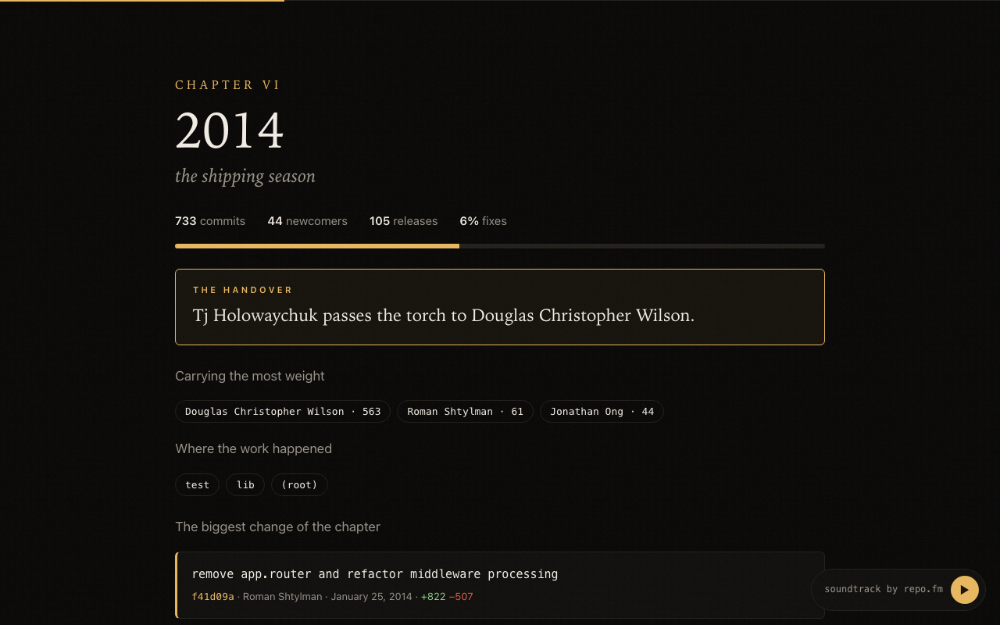
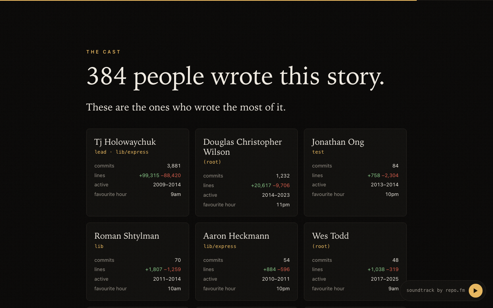

<h1 align="center">🎬 repo.film</h1>
<p align="center"><b>Every repository is a documentary.</b><br>One command turns any git history into a cinematic film you can scroll, with a soundtrack played from its commits.</p>

<p align="center">
  <a href="https://fixcoreai-cloud.github.io/repo.film/express.html"><b>▶ Watch Express</b></a> ·
  <a href="https://fixcoreai-cloud.github.io/repo.film/vite.html"><b>▶ Watch Vite</b></a>
</p>

<p align="center"></p>

```bash
cd your-project
npx github:fixcoreai-cloud/repo.film --open
```

No API keys, no account, no server. It reads your local `git log` and writes one self-contained HTML file you can open, share or host anywhere.

## What's in the film

- **Cold open.** The first commit, who made it, and the files it touched.
- **The first ones.** The founders, and how many days it stayed a party of one.
- **The shape of it.** Every month of the project as one bar chart.
- **Chapters.** One per year (or per quarter for young projects), each with its mood: *the beginning, the peak, the arrivals, the shipping season, the repair years, the quiet.*
- **The handover.** The moment the person carrying the project changes. Express: TJ Holowaychuk to Douglas Christopher Wilson, 2014. Vite: Evan You to patak, 2022.
- **The darkest week.** The week with the most reverts and fixes.
- **The great rewrite.** The biggest single deletion in history, and the big bang that added the most.
- **The longest silence.** The longest gap without a commit, and the commit that broke it.
- **The cast.** Who wrote the most, where they worked, their favourite hour. Plus awards: Night Owl, Weekend Warrior, Longest Serving, The Gardener.
- **When they worked.** A 7×24 heatmap, in each author's own time zone.
- **What they kept saying.** The words that keep showing up in commit messages.
- **Credits.** Every contributor rolls past, the way they should.
- **Soundtrack.** The last 300 commits played as music by [repo.fm](https://github.com/fixcoreai-cloud/repo.fm).

## Nothing is made up

There's no LLM narration and nothing invented. Every scene is computed from the history, and every commit card links to the real commit. If the film says something happened, you can click it and see it happen.

<p align="center"></p>

## Options

```
npx github:fixcoreai-cloud/repo.film [path] [options]

  -o, --out <file>   where to write the film (default: <repo>.film.html)
  -n, --max <count>  only film the most recent <count> commits
  --name <name>      title for the film (default: from the git remote)
  --open             open the film when it's done
```

It uses `.mailmap` when present, merges authors who used several emails under one name, keeps bots out of the cast, and ignores lockfiles, `dist/` and vendored code when it counts lines. Express's 17 years film in 0.5s; Vite's 9,774 commits in 2.5s.

Shallow clone? Run `git fetch --unshallow` first so the film has the whole story.

## Ideas welcome

A GitHub Action that publishes your film to Pages on every release. Per-directory films. A "this year" cut. Open an issue or a PR.

MIT
